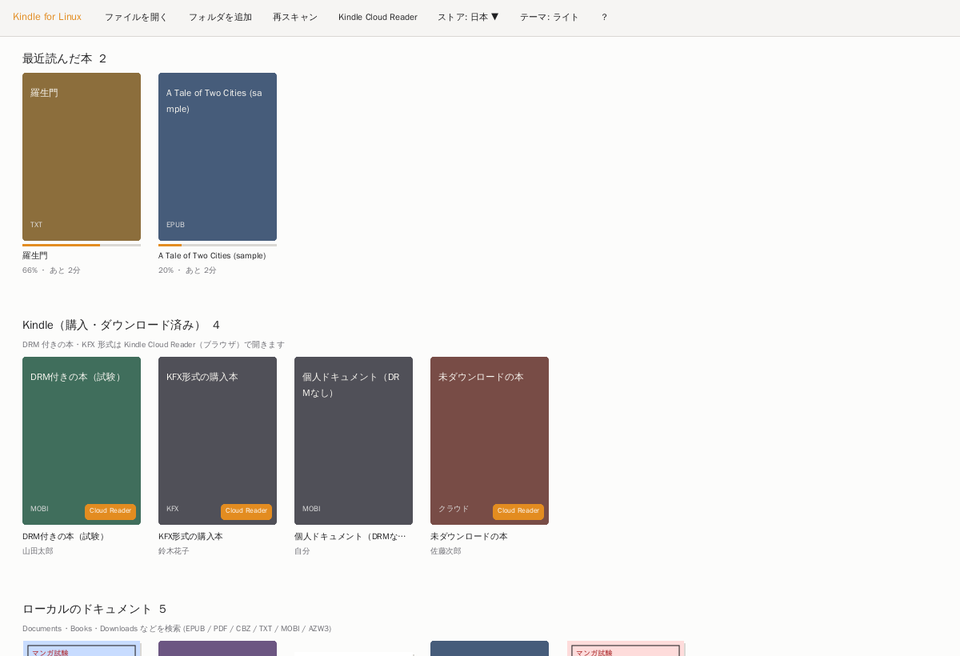
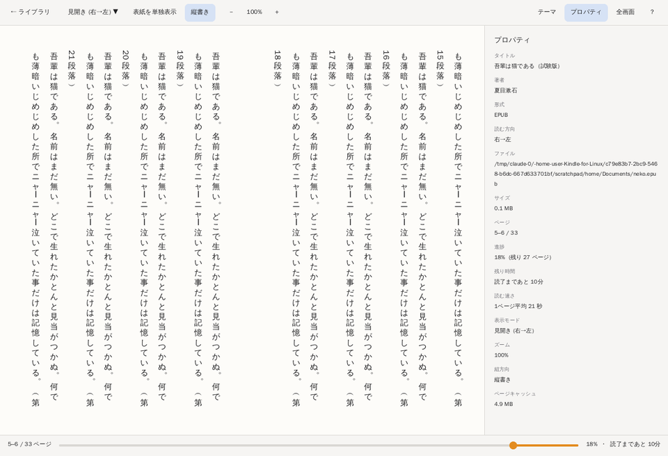
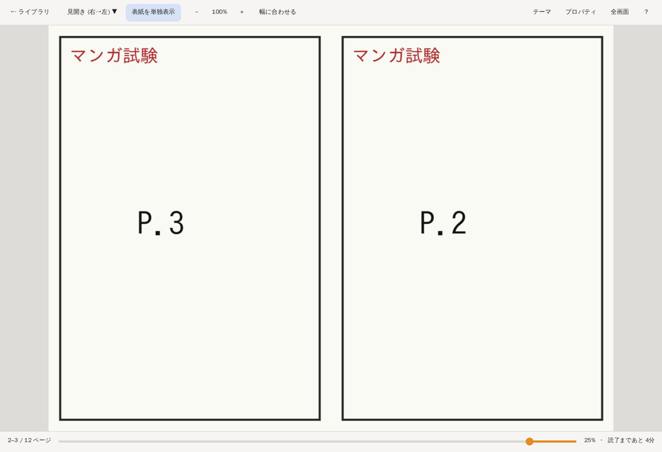
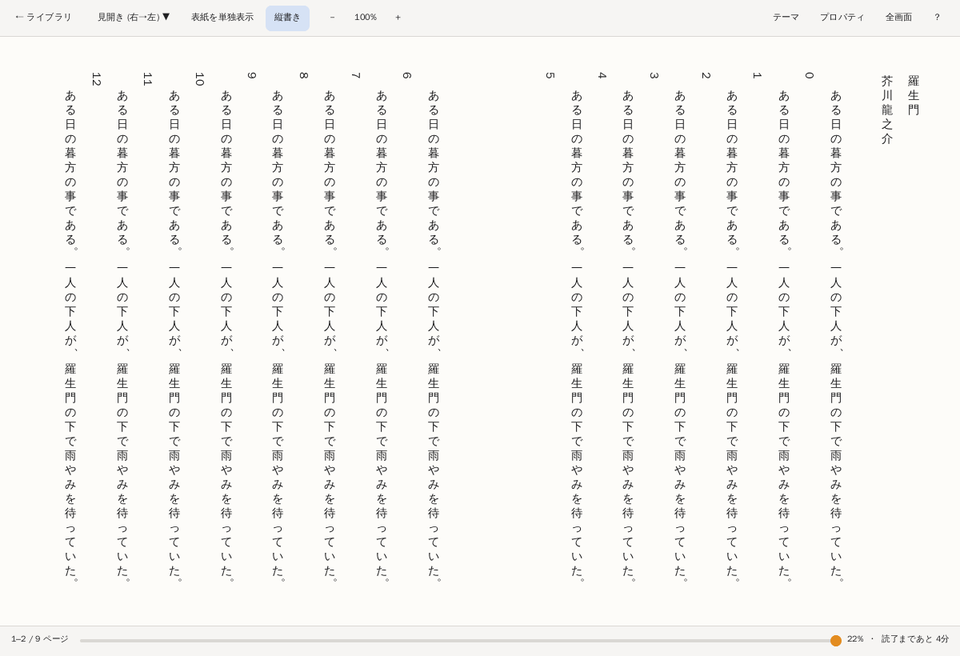
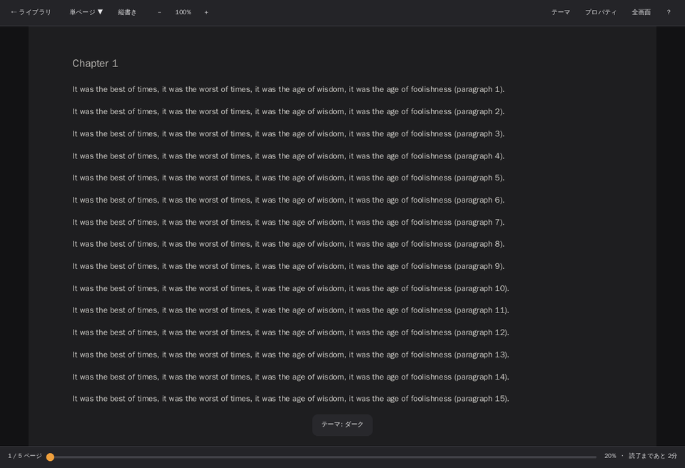

# Kindle for Linux

Arch Linux などの Linux で、Kindle の本・電子書籍・漫画を読むための**超軽量リーダー**です。

- **Rust 製**。GUI は自作で、GPU を使わずソフトウェアで描画します（winit + softbuffer）
- **アイドル時の CPU 使用率 0%**。描画はキー操作・マウス操作のときだけ行います
- 主要ロジックは **Lean 4 で定理証明** 済み。さらに Rust の実装が Lean のモデルと一致することをテストで確認しています（[検証](#検証-lean-4)）



| 縦書き・見開き（右→左） | 漫画の見開き（右→左） |
| --- | --- |
|  |  |
| **青空文庫 TXT（ルビ除去・Shift_JIS 対応）** | **ダークテーマ・横書き** |
|  |  |

## 機能

### ページの並べ方
- **単ページ**
- **見開き（右→左）**: 漫画や縦書きの本向け。← キーまたは画面左側のクリックで次のページへ進みます
- **見開き（左→右）**: 横書きの本向け
- **縦スクロール**: Web トゥーンのように縦に連続して表示します
- 見開きでは「表紙を単独表示」を切り替えられます（`[表紙] [1,2] [3,4]…` / `[0,1] [2,3]…`）
- テキストの本は **縦書き / 横書き** を切り替えられます（禁則処理、縦書き用の句読点・括弧に対応）

### 拡大・縮小
- 25%〜800% の段階ズーム（Ctrl + ホイール、`+` / `-` / `0`）
- 「ページ全体に合わせる」と「幅に合わせる」を切り替えられます
- 拡大中はドラッグやホイールで表示位置を移動できます
- テキストの本では、拡大すると文字サイズを変えて組み直します

### 進捗の表示
- 画面下に `12–13 / 200 ページ ・ 6% ・ 読了まであと 1時間20分` と表示します
- 残り時間は、ページをめくる間隔から算出したあなたの**読む速さ**（指数移動平均）で計算します。1 秒未満の空送りや 10 分を超える中断は計算に入れません
- 本ごとに読む速さを記録するため、漫画と小説で別々の速さを使います

### 画面上のメニューとプロパティ
- 上部ツールバー: ライブラリ、表示モード（ドロップダウン）、表紙単独表示、縦書き、ズーム、幅合わせ、テーマ、プロパティ、全画面、ヘルプ
- 下部ステータスバー: ページ番号、スライダー（右→左の本では向きが逆になります）、進捗率、残り時間
- **プロパティパネル**: タイトル、著者、形式、ASIN、読む方向、ファイル、サイズ、ページ、進捗、残り時間、読む速さ、表示モード、ズーム、組方向、メモリ使用量

### 起動時のライブラリ画面
1. **最近読んだ本**: 進捗バー、進捗率、残り時間付き
2. **Kindle（購入・ダウンロード済み）**:
   - Wine で動かしている Kindle for PC のダウンロードフォルダ（`My Kindle Content`。`~/.wine`、Bottles、`$WINEPREFIX` などを探します）
   - USB で接続した Kindle 端末（`/run/media/*/Kindle/documents`）
   - Kindle for PC の `KindleSyncMetadataCache.xml` に載っている、**未ダウンロードの購入本**
3. **ローカルのドキュメント**: `~/Documents`、`~/Books`、`~/Downloads`、`~/Comics`、`~/Manga`、XDG の文書フォルダと、「フォルダを追加」で登録したフォルダ

おすすめの本は表示しません。

### 対応形式

| 形式 | 表示 |
| --- | --- |
| EPUB（リフロー型） | ✅ テキストを組み直して表示（縦書き・横書き） |
| EPUB（固定レイアウト・漫画） | ✅ 画像ページとして表示（`page-progression-direction` に従う） |
| CBZ / ZIP / 画像フォルダ | ✅ |
| PDF | ✅ `poppler`（`pdftoppm`）または `mupdf-tools`（`mutool`）を利用 |
| TXT | ✅ UTF-8 / Shift_JIS / EUC-JP / UTF-16。青空文庫のルビ・注記を除去 |
| MOBI / AZW3（DRM なし） | ✅ PalmDOC 圧縮または無圧縮のもの。画像だけの本にも対応 |
| Kindle の購入本（DRM 付き AZW / KFX） | ⚠️ タイトル・著者・ASIN・表紙は表示します。**本文はこのアプリでは表示せず、Kindle Cloud Reader をブラウザで開きます** |

> **DRM について**: Amazon で購入した Kindle 本は DRM で保護されています。このアプリは DRM を解除しません。著作権法の技術的保護手段の回避にあたるためです。
> 購入本は、ライブラリでクリックすると `https://read.amazon.co.jp/?asin=…`（ストアは切り替え可能）が開きます。
> Amazon、Kindle は Amazon.com, Inc. またはその関連会社の商標です。本ソフトウェアは Amazon とは関係のない非公式プロジェクトです。

## 軽さ（実測）

Xvfb 上の 1200×820 ウィンドウで計測しました。

| 項目 | 値 |
| --- | --- |
| バイナリサイズ | 約 3.7 MB（release, strip 済み） |
| メモリ（ライブラリ画面） | 約 19 MB（RSS） |
| メモリ（小説を表示中） | 約 22〜26 MB |
| メモリ（漫画を拡大表示中） | 約 65 MB（ページキャッシュの上限は既定 96 MB で、設定で変更可能） |
| アイドル時の CPU | 10 秒間で 0 tick（0%） |
| GPU | 使用しない（ソフトウェア描画、共有メモリでの転送のみ） |

軽くするための主な工夫:
- イベントがあるときだけ再描画します
- ページは別スレッドで、表示サイズちょうどに縮小してキャッシュします（LRU、メモリ上限付き）
- CJK フォントはメモリマップで読み込み、使う文字だけをラスタライズします
- PDF の描画は外部コマンドに任せるため、本体に大きな PDF エンジンを含みません

## インストール (Arch Linux)

PKGBUILD は 2 種類あります。

| PKGBUILD | パッケージ名 | ビルド元 |
| --- | --- | --- |
| `packaging/arch-local/PKGBUILD` | `kindle-for-linux` | 手元に clone したリポジトリの、今チェックアウトしているブランチ（コミット済みの内容） |
| `packaging/arch/PKGBUILD` | `kindle-for-linux-git` | GitHub のデフォルトブランチの最新版（AUR 向け。`.SRCINFO` 付き） |

手元の clone からビルドする場合（マージ前のブランチでも使えます）:

```sh
git clone https://github.com/TarouZirou/Kindle-for-Linux.git
cd Kindle-for-Linux
git checkout <読みたいブランチ>         # 例: claude/kindle-arch-linux-viewer-1c3al9
cd packaging/arch-local
makepkg -si
```

GitHub の最新版からビルドする場合:

```sh
cd Kindle-for-Linux/packaging/arch
makepkg -si
```

どちらも `check()` で Lean のモデルとの差分テストを含むテスト一式を実行してから、パッケージを作ります。

推奨パッケージ: `noto-fonts-cjk`（日本語フォント）、`poppler`（PDF）、`zenity`（ファイル選択ダイアログ）、`xdg-utils`

手動でビルドする場合:

```sh
sudo pacman -S --needed rust noto-fonts-cjk poppler zenity
cargo build --release
sudo make install                       # /usr/bin/kindle-for-linux とデスクトップエントリ
```

## 使い方

```sh
kindle-for-linux                        # ライブラリを開く
kindle-for-linux 本.epub                # 本を直接開く
kindle-for-linux --region us            # Cloud Reader のストアを変更（jp us uk de fr es it ca au in br mx）
```

ファイルをウィンドウにドラッグ＆ドロップしても開けます（X11 の場合）。

| 操作 | 動作 |
| --- | --- |
| → / ← | ページ送り（右→左の本では ← が「次へ」） |
| Space / PageDown、Shift+Space / PageUp | 次へ / 前へ |
| 画面の左右の端をクリック | ページ送り |
| Home / End | 最初 / 最後のページ |
| Ctrl + ホイール、`+` `-` `0` | 拡大 / 縮小 / 100% |
| `W` | 幅に合わせる |
| `M` | 表示モードの切り替え |
| `C` | 表紙を単独表示 |
| `V` | 縦書き / 横書き |
| `I` | プロパティ |
| `T` | テーマ（ライト / セピア / ダーク） |
| F11 / `F`、Esc | 全画面 / 解除 |
| `L` / Backspace | ライブラリへ戻る |
| Ctrl + O / Ctrl + Q | ファイルを開く / 終了 |
| F1 / `?` | ヘルプ |

### 設定ファイル

| 内容 | 場所 |
| --- | --- |
| 設定 | `~/.config/kindle-for-linux/config`（`folder=`、`kindle_folder=`、`font_px=`、`cache_mb=`、`region=`、`theme=`） |
| 読書履歴・位置・読む速さ | `~/.local/share/kindle-for-linux/history.tsv` |
| 表紙サムネイル | `~/.cache/kindle-for-linux/thumbs/` |

フォントは `KFL_FONT=/path/to/font.ttc` で指定できます。

## 検証 (Lean 4)

ページの並べ方・ページ送り・ズーム・スクロール・進捗・残り時間の計算は、副作用のない純粋関数として `src/core/` にまとめてあります。これらは `proof/KindleCore/` で Lean 4 の定義として**同じ形で**書かれ、性質が証明されています。

### 証明されている主な性質

| ファイル | 定理 | 意味 |
| --- | --- | --- |
| Layout | `mem_spreadPages` | 各ページはちょうど 1 つの見開きに属する（見開きは本を重複なく分割する） |
| Layout | `nextPage_lt`, `prevPage_lt`, `normalize_lt` | ページ送り・正規化の結果が常に本の範囲内に収まる（範囲外アクセスが起きない） |
| Layout | `nextPage_ge`, `prevPage_le` | 「次へ」で戻ることも、「前へ」で進むこともない |
| Layout | `prev_next_single`, `prev_next_spread` | 「次へ」→「前へ」で元のページ（見開き）に戻る |
| Layout | `mem_visible`, `visible_lt`, `visible_length_le` | 現在のページは必ず画面に表示され、表示されるのは本の範囲内の最大 2 ページ |
| Layout | `rtl_mirror` | 右→左の見開きは、左→右の見開きの鏡像 |
| Zoom | `zoomIn_bounds`, `zoomOut_bounds`, `clampZoom_bounds` | ズームは常に 25〜800% |
| Zoom | `zoomIn_gt`, `zoomOut_lt` | 上限・下限でない限り、拡大・縮小は必ず効く |
| Zoom | `zoomOut_zoomIn`, `zoomIn_zoomOut` | 拡大してから縮小すると元の倍率に戻る |
| Zoom | `fitSize_le`, `fitSize_touches` | 「ページ全体に合わせる」と、表示枠を超えず、少なくとも一辺は枠に接する |
| Scroll | `clampOffset_fits`, `clampOffset_small`, `centerPad_fits` | スクロール・パン位置がコンテンツの外に出ない |
| Scroll | `locate_lt`, `locate_mono` | 位置からページを探す関数（縦スクロール・リフロー後の位置復元に使用）は常に有効な添字を返し、単調 |
| Progress | `percent_le_100`, `percent_end`, `percent_lt_100`, `percent_mono` | 進捗は 0〜100% で単調に増え、100% になるのは最後のページだけ |
| Progress | `updateSpeed_bounds`, `acceptSample_bounds` | 読む速さの推定値は常に 1 秒〜10 分/ページの範囲 |
| Progress | `remainingMs_end`, `remainingMs_anti`, `remainingMs_bounded` | 残り時間は最後で 0、読み進めるほど減り、`u64` でオーバーフローしない |
| Progress | `ceilMinutes_pos`, `ceilMinutes_ge`, `hoursMinutes_*` | 読み終えていなければ「0分」とは表示せず、表示は実際の見積もりより短くならない |

`sorry`、`admit`、`axiom` は使っていません（`scripts/verify.sh` で確認しています）。

### Rust 実装との対応

Lean の定義から入出力ベクトル 8,500 件を生成します（`proof/Vectors.lean` → `tests/vectors.txt`）。`cargo test` では、Rust の実装がそのすべてで同じ結果を返すことを確認します（`tests/lean_vectors.rs`）。わざとバグを入れた実装（off-by-one など）で、このテストが失敗することも確認済みです。

```sh
./scripts/verify.sh     # Lean の証明チェック → ベクトル生成 → Rust の差分テスト
```

（elan で Lean 4.24.0 を入れておく必要があります。GitHub Actions 用の `.github/workflows/verify.yml` も同梱しています。）

### 検証の範囲と限界

- **証明済み**: 上の表の、純粋関数のレベルでの性質です。
- **テストで確認**: Rust 版が Lean 版と一致するかどうか。ただし Rust のコード自体は証明されていません。ベクトルによる差分テストなので、網羅的な保証ではありません。
- **未検証**: ファイル形式の解析（EPUB / MOBI / PDF / ZIP）、文字の組版、描画、ウィンドウシステムとのやり取り。これらは通常のユニットテストと実際の動作確認だけで確認しています。

「このソフトに一切バグがない」ことを証明するものではありません。ページ送りや進捗計算など、**証明した部分のロジックには上の表のような種類のバグが起きない**、という保証です。

## 開発

```
src/core/      検証済みの純粋ロジック（layout / zoom / scroll / progress）
src/doc/       形式ごとの読み込み（epub, mobi, pdf, images, text, markup）
src/app.rs     画面と入力処理（ライブラリ・リーダー）
src/canvas.rs  ソフトウェア描画（矩形、角丸、画像の転送、文字）
src/font.rs    フォントの読み込み（mmap）とグリフキャッシュ、縦書き用の字形
src/worker.rs  ページ描画とサムネイルのバックグラウンドスレッド
src/library.rs Kindle フォルダ・ローカル文書の探索とサムネイル
proof/         Lean 4 による形式モデルと証明
```

ライセンス: MIT
